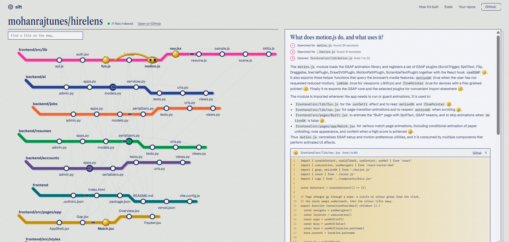

# Sift

[](https://github.com/mohanrajtunes/sift/actions/workflows/tests.yml)

Paste a GitHub repo, ask it anything, and see the exact lines that answer it.

**Live:** https://sift-swart-psi.vercel.app

> The API runs on a free tier and sleeps when idle. The first request after a while can take about 50 seconds.



Sift indexes a repo, searches it with keyword and vector search together, and runs an agent that opens files and follows references until it can answer. Every claim in the answer cites the lines it came from. The repo shows up as a metro map, and you can watch the agent ride it while it works.

## How well it works

24 questions about one real repo, where I already knew which file held each answer:

| Search | Right file in top 5 |
| --- | --- |
| Keyword | 71% |
| Vector | 100% |
| Hybrid (default) | 96% |

Agent answers: 96% correct, 87% backed by the lines they cite (23 questions). Run it with `python manage.py run_evals --answers`.

## How it works

1. **Index:** download the repo zip, skip junk (node_modules, builds, big files), cut Python by function and class and everything else into 60-line windows, embed each chunk with Gemini (768 dims), store in Postgres with pgvector.
2. **Search:** keyword and vector rankings merged with reciprocal rank fusion.
3. **Agent:** an LLM (Groq, gpt-oss-120b) with three tools: `search_code`, `read_file`, `find_references`. Up to 6 steps.
4. **Answer:** citations are checked against the excerpts the agent actually saw. Steps and answer stream to the browser over server-sent events.

## Stack

Django REST Framework, Postgres + pgvector (Neon), Gemini embeddings, Groq, React, Vite, GSAP.

## Run it locally

Backend:

```bash
cd backend
python -m venv venv
venv\Scripts\activate          # macOS/Linux: source venv/bin/activate
pip install -r requirements.txt
python manage.py migrate
python manage.py runserver
```

`backend/.env` needs `GOOGLE_API_KEY`, `GROQ_API_KEY`, `DATABASE_URL` (Postgres with pgvector) and `DJANGO_DEBUG=1` for local work.

Run the tests with `python manage.py test`.

Frontend:

```bash
cd frontend
npm install
npm run dev
```

Set `VITE_API_URL` if the API isn't at `http://127.0.0.1:8000/api`.

## Limits

Public repos only, up to 50 MB and 1,500 files. The public demo allows 30 questions and 5 new repos per hour per visitor.

## Deploy

- **Backend (Render):** root directory `backend`, build `pip install -r requirements.txt && python manage.py migrate`, start `gunicorn config.wsgi`. `gunicorn.conf.py` sets threaded workers so live answers can stream. Env: `DATABASE_URL`, `GOOGLE_API_KEY`, `GROQ_API_KEY`, `DJANGO_SECRET_KEY`, `DJANGO_DEBUG=0`, `ALLOWED_HOSTS=<your-app>.onrender.com`, `CORS_ALLOWED_ORIGINS=https://<your-site>.vercel.app`.
- **Frontend (Vercel):** root directory `frontend`, env `VITE_API_URL=https://<your-app>.onrender.com/api`. `vercel.json` sends every path to the app so page links work.

## License

MIT